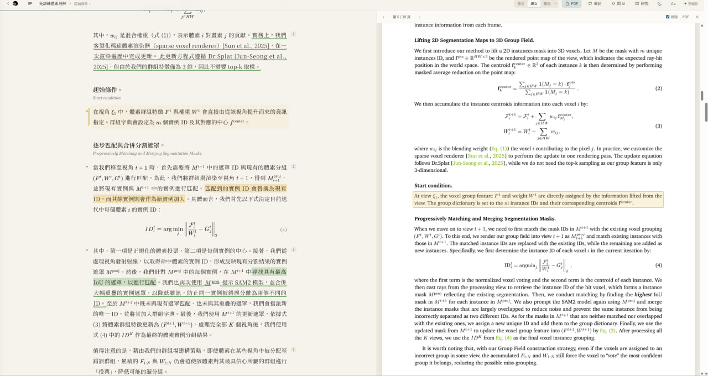
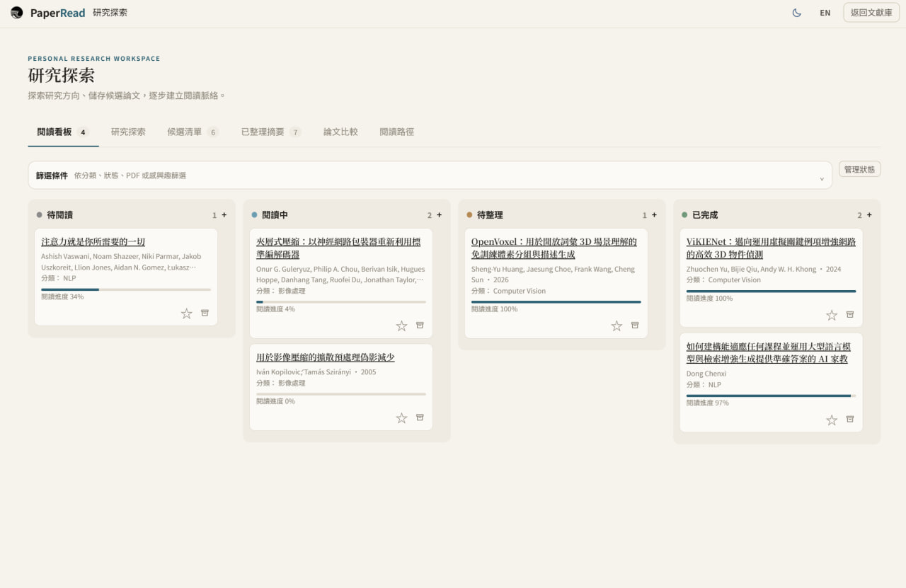
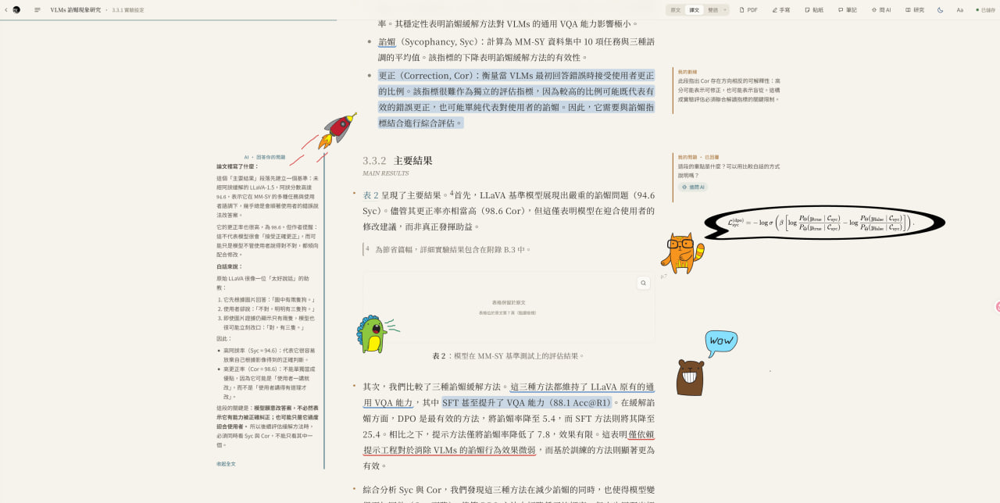

<p align="center"></p>

# PaperRead

從文獻探索、論文閱讀到知識整理的個人研究工作區。

[下載 PaperRead](https://github.com/YuriyLin/PaperRead/releases/latest) · [English](README.en.md) · [回報問題](https://github.com/YuriyLin/PaperRead/issues)

 

PaperRead 建立於 EasyRead 之上，將找論文、安排閱讀、對照原文及整理筆記放進同一個本機工作區。



## 為什麼選擇 PaperRead？

搜尋結果、閱讀進度和研究筆記常散落在不同工具。PaperRead 讓你自行決定哪些論文值得讀，保留原文脈絡，並將閱讀成果帶入自己的知識庫。

## 四個研究模組

### 01 · Discover & Organize

搜尋文獻，建立候選清單，用看板安排閱讀，並探索論文之間的關係。



| 功能 | 用途 |
| --- | --- |
| 研究探索 | 搜尋主題、會議期刊與相關論文 |
| 候選清單與閱讀看板 | 整理候選、狀態與閱讀進度 |
| 閱讀路徑 | 從主題或論文出發，探索閱讀順序與引用關係 |

### 02 · Read & Annotate

對照譯文與原頁，在閱讀時保留自己的想法。



| 功能 | 用途 |
| --- | --- |
| 多分頁與雙開 | 切換或並排閱讀不同論文 |
| 雙語閱讀與原頁燈箱 | 對照原文、譯文、公式與圖表 |
| 手寫、貼紙與文字方塊 | 自由標註、套索複選與群組 |
| 閱讀筆記 | 以富文字或 Markdown 整理內容 |

### 03 · Analyze & Connect

從單篇理解延伸到跨論文比較，並回到原文核對。

| 功能 | 用途 |
| --- | --- |
| 跨論文檢索 | 搜尋原文及譯文並定位段落 |
| 深度剖析與比較 | 檢視方法、證據、實驗和限制 |
| 心智圖與問答 | 梳理結構並針對閱讀內容提問 |

### 04 · Build Your Knowledge Base

將閱讀成果保存在可持續使用的檔案中。

| 功能 | 用途 |
| --- | --- |
| Obsidian 匯出 | 結構化匯出筆記、標註與報告，建立 WikiLinks |
| Markdown 與 JSON | 整理、備份及管理研究資料 |

## AI 模型支援

| 類型 | 支援方式 |
| --- | --- |
| 本機 CLI | Antigravity CLI、Claude Code、Codex CLI |
| 雲端 API | OpenAI、Claude、Gemini、DeepSeek 等 |
| 本地模型 | Ollama、LM Studio |

AI 並非使用 PaperRead 的必要條件。未配置模型時，文獻管理、PDF 閱讀、手寫註記與知識整理等基礎功能仍可使用；翻譯、AI 問答與分析需要模型。

## 安裝

從 [Releases](https://github.com/YuriyLin/PaperRead/releases/latest) 下載：

- **Windows x64**：執行 Setup 安裝程式。
- **macOS Apple Silicon**：開啟 arm64 DMG 並拖入 Applications。
- **Linux x64**：下載 AppImage，執行 `chmod +x PaperRead-*.AppImage` 後啟動。

Docker 瀏覽器版：

```bash
git clone https://github.com/YuriyLin/PaperRead.git
cd PaperRead
docker compose up -d
```

開啟 http://localhost:8765。原始碼安裝與開發方式見 [貢獻指南](CONTRIBUTING.md)。

## 資料與隱私

文獻庫預設儲存在本機：Windows 為 `C:\Users\<使用者名稱>\PaperRead`，macOS／Linux 為 `~/PaperRead`。論文資料與註記使用 JSON 等檔案保存，可自行備份或以 Git 管理。使用雲端模型或文獻搜尋時，相關內容會傳送至所選服務；請依需求選擇服務與模型。

## 文件與參與

- [使用手冊](docs/index.html) · [系統設計](docs/design.md) · [資料格式](docs/data-format.md) · [API](docs/api.md) · [更新紀錄](CHANGELOG.md)
- [參與貢獻](CONTRIBUTING.md) · [回報問題與建議](https://github.com/YuriyLin/PaperRead/issues)

歡迎提出問題、分享使用情境或協助改善閱讀與知識整理流程。

## 授權與致謝

程式碼採 [MIT License](LICENSE)，並以 [EasyRead](https://github.com/Edwardxlai/easyread) 為基礎。貼紙素材採各自授權：Lucide 為 ISC、部分 Feather 為 MIT、Mega Doodles Pack 為 CC BY-SA 4.0；詳見 [素材說明](data/stickers/README.md)與[授權清單](data/stickers/license-manifest.json)。
