# Academic Sticker Collection 素材總覽

共 199 個透明背景 SVG：100 個 Lucide 線條圖示，以及 99 個 Mega Doodles 彩色手繪插畫。Lucide 圖示顏色為 currentColor。

素材直接來自 [Lucide](https://github.com/lucide-icons/lucide/tree/929b22faab58fd25c9ed4f891e09cc70f7e661ac/icons)；SVG Repo 亦有 [Lucide 系列](https://www.svgrepo.com/collection/lucide-line-icons/)。

授權：Lucide 為 ISC，部分另含 Feather MIT；Mega Doodles 為 CC BY-SA 4.0。發佈素材與含素材的輸出時，應隨附適用授權與版權聲明；完整文字見 [LICENSE-LUCIDE.txt](../../public/stickers/LICENSE-LUCIDE.txt)。Mega Doodles 必須標示作者 Maria Letta、來源和授權連結，註明是否修改；改作須以相同或相容授權分享。PDF 匯出時的授權附帶方式尚未實作。

便條紙與對話框是圖示，不是可輸入文字的模板；素材已整合至翻譯正文的手寫層，離線 HTML 可包含已使用的素材。PDF 匯出與授權標示仍待實作。

| 分類 | 數量 |
| --- | ---: |
| academic | 15 |
| important | 12 |
| question | 7 |
| warning | 5 |
| science | 9 |
| mathematics | 11 |
| machine-learning | 10 |
| arrows | 10 |
| shapes | 9 |
| sticky-notes | 4 |
| decorative | 107 |

## 授權與排除來源

- Flaticon：條款限制圖示集合、第三方使用及再散布，本用途排除。
- Icons8：未取得書面同意前，禁止散布獨立 SVG，故排除。
- Storyset、Open Doodles：本用途之使用者重複使用權利未確認，暫不收錄；不代表不能商用。
- SVG Repo：各素材授權不同；本次改由 Lucide 上游原始專案取得並保留版本。

上述用途判斷依授權的一般使用與散布條款推論，並非作者針對各個情境個別確認。詳細判斷及來源見 [license-manifest.json](license-manifest.json)。

## academic

| 預覽 | 素材 |
| --- | --- |
|  | [Book Open](https://github.com/lucide-icons/lucide/blob/929b22faab58fd25c9ed4f891e09cc70f7e661ac/icons/book-open.svg) |
|  | [Book Open Check](https://github.com/lucide-icons/lucide/blob/929b22faab58fd25c9ed4f891e09cc70f7e661ac/icons/book-open-check.svg) |
|  | [Library](https://github.com/lucide-icons/lucide/blob/929b22faab58fd25c9ed4f891e09cc70f7e661ac/icons/library.svg) |
|  | [Graduation Cap](https://github.com/lucide-icons/lucide/blob/929b22faab58fd25c9ed4f891e09cc70f7e661ac/icons/graduation-cap.svg) |
|  | [Scroll Text](https://github.com/lucide-icons/lucide/blob/929b22faab58fd25c9ed4f891e09cc70f7e661ac/icons/scroll-text.svg) |
|  | [Notebook Text](https://github.com/lucide-icons/lucide/blob/929b22faab58fd25c9ed4f891e09cc70f7e661ac/icons/notebook-text.svg) |
|  | [Notebook Pen](https://github.com/lucide-icons/lucide/blob/929b22faab58fd25c9ed4f891e09cc70f7e661ac/icons/notebook-pen.svg) |
|  | [Book Copy](https://github.com/lucide-icons/lucide/blob/929b22faab58fd25c9ed4f891e09cc70f7e661ac/icons/book-copy.svg) |
|  | [File Text](https://github.com/lucide-icons/lucide/blob/929b22faab58fd25c9ed4f891e09cc70f7e661ac/icons/file-text.svg) |
|  | [File Search](https://github.com/lucide-icons/lucide/blob/929b22faab58fd25c9ed4f891e09cc70f7e661ac/icons/file-search.svg) |
|  | [Search](https://github.com/lucide-icons/lucide/blob/929b22faab58fd25c9ed4f891e09cc70f7e661ac/icons/search.svg) |
|  | [Microscope](https://github.com/lucide-icons/lucide/blob/929b22faab58fd25c9ed4f891e09cc70f7e661ac/icons/microscope.svg) |
|  | [Highlighter](https://github.com/lucide-icons/lucide/blob/929b22faab58fd25c9ed4f891e09cc70f7e661ac/icons/highlighter.svg) |
|  | [Pencil](https://github.com/lucide-icons/lucide/blob/929b22faab58fd25c9ed4f891e09cc70f7e661ac/icons/pencil.svg) |
|  | [Ruler](https://github.com/lucide-icons/lucide/blob/929b22faab58fd25c9ed4f891e09cc70f7e661ac/icons/ruler.svg) |

## important

| 預覽 | 素材 |
| --- | --- |
|  | [Circle Alert](https://github.com/lucide-icons/lucide/blob/929b22faab58fd25c9ed4f891e09cc70f7e661ac/icons/circle-alert.svg) |
|  | [Badge Alert](https://github.com/lucide-icons/lucide/blob/929b22faab58fd25c9ed4f891e09cc70f7e661ac/icons/badge-alert.svg) |
|  | [Octagon Alert](https://github.com/lucide-icons/lucide/blob/929b22faab58fd25c9ed4f891e09cc70f7e661ac/icons/octagon-alert.svg) |
|  | [Flag](https://github.com/lucide-icons/lucide/blob/929b22faab58fd25c9ed4f891e09cc70f7e661ac/icons/flag.svg) |
|  | [Pin](https://github.com/lucide-icons/lucide/blob/929b22faab58fd25c9ed4f891e09cc70f7e661ac/icons/pin.svg) |
|  | [Lightbulb](https://github.com/lucide-icons/lucide/blob/929b22faab58fd25c9ed4f891e09cc70f7e661ac/icons/lightbulb.svg) |
|  | [Lightbulb Off](https://github.com/lucide-icons/lucide/blob/929b22faab58fd25c9ed4f891e09cc70f7e661ac/icons/lightbulb-off.svg) |
|  | [Check](https://github.com/lucide-icons/lucide/blob/929b22faab58fd25c9ed4f891e09cc70f7e661ac/icons/check.svg) |
|  | [Check Check](https://github.com/lucide-icons/lucide/blob/929b22faab58fd25c9ed4f891e09cc70f7e661ac/icons/check-check.svg) |
|  | [Circle Check](https://github.com/lucide-icons/lucide/blob/929b22faab58fd25c9ed4f891e09cc70f7e661ac/icons/circle-check.svg) |
|  | [Star](https://github.com/lucide-icons/lucide/blob/929b22faab58fd25c9ed4f891e09cc70f7e661ac/icons/star.svg) |
|  | [Bookmark](https://github.com/lucide-icons/lucide/blob/929b22faab58fd25c9ed4f891e09cc70f7e661ac/icons/bookmark.svg) |

## question

| 預覽 | 素材 |
| --- | --- |
|  | [Circle Question Mark](https://github.com/lucide-icons/lucide/blob/929b22faab58fd25c9ed4f891e09cc70f7e661ac/icons/circle-question-mark.svg) |
|  | [Message Circle Question Mark](https://github.com/lucide-icons/lucide/blob/929b22faab58fd25c9ed4f891e09cc70f7e661ac/icons/message-circle-question-mark.svg) |
|  | [File Question Mark](https://github.com/lucide-icons/lucide/blob/929b22faab58fd25c9ed4f891e09cc70f7e661ac/icons/file-question-mark.svg) |
|  | [Message Circle](https://github.com/lucide-icons/lucide/blob/929b22faab58fd25c9ed4f891e09cc70f7e661ac/icons/message-circle.svg) |
|  | [Message Square](https://github.com/lucide-icons/lucide/blob/929b22faab58fd25c9ed4f891e09cc70f7e661ac/icons/message-square.svg) |
|  | [Messages Square](https://github.com/lucide-icons/lucide/blob/929b22faab58fd25c9ed4f891e09cc70f7e661ac/icons/messages-square.svg) |
|  | [Message Square Text](https://github.com/lucide-icons/lucide/blob/929b22faab58fd25c9ed4f891e09cc70f7e661ac/icons/message-square-text.svg) |

## warning

| 預覽 | 素材 |
| --- | --- |
|  | [Triangle Alert](https://github.com/lucide-icons/lucide/blob/929b22faab58fd25c9ed4f891e09cc70f7e661ac/icons/triangle-alert.svg) |
|  | [Shield Alert](https://github.com/lucide-icons/lucide/blob/929b22faab58fd25c9ed4f891e09cc70f7e661ac/icons/shield-alert.svg) |
|  | [Shield Question Mark](https://github.com/lucide-icons/lucide/blob/929b22faab58fd25c9ed4f891e09cc70f7e661ac/icons/shield-question-mark.svg) |
|  | [Ban](https://github.com/lucide-icons/lucide/blob/929b22faab58fd25c9ed4f891e09cc70f7e661ac/icons/ban.svg) |
|  | [Circle X](https://github.com/lucide-icons/lucide/blob/929b22faab58fd25c9ed4f891e09cc70f7e661ac/icons/circle-x.svg) |

## science

| 預覽 | 素材 |
| --- | --- |
|  | [Atom](https://github.com/lucide-icons/lucide/blob/929b22faab58fd25c9ed4f891e09cc70f7e661ac/icons/atom.svg) |
|  | [Flask Conical](https://github.com/lucide-icons/lucide/blob/929b22faab58fd25c9ed4f891e09cc70f7e661ac/icons/flask-conical.svg) |
|  | [Flask Round](https://github.com/lucide-icons/lucide/blob/929b22faab58fd25c9ed4f891e09cc70f7e661ac/icons/flask-round.svg) |
|  | [Test Tube](https://github.com/lucide-icons/lucide/blob/929b22faab58fd25c9ed4f891e09cc70f7e661ac/icons/test-tube.svg) |
|  | [Test Tubes](https://github.com/lucide-icons/lucide/blob/929b22faab58fd25c9ed4f891e09cc70f7e661ac/icons/test-tubes.svg) |
|  | [Dna](https://github.com/lucide-icons/lucide/blob/929b22faab58fd25c9ed4f891e09cc70f7e661ac/icons/dna.svg) |
|  | [Beaker](https://github.com/lucide-icons/lucide/blob/929b22faab58fd25c9ed4f891e09cc70f7e661ac/icons/beaker.svg) |
|  | [Thermometer](https://github.com/lucide-icons/lucide/blob/929b22faab58fd25c9ed4f891e09cc70f7e661ac/icons/thermometer.svg) |
|  | [Telescope](https://github.com/lucide-icons/lucide/blob/929b22faab58fd25c9ed4f891e09cc70f7e661ac/icons/telescope.svg) |

## mathematics

| 預覽 | 素材 |
| --- | --- |
|  | [Sigma](https://github.com/lucide-icons/lucide/blob/929b22faab58fd25c9ed4f891e09cc70f7e661ac/icons/sigma.svg) |
|  | [Pi](https://github.com/lucide-icons/lucide/blob/929b22faab58fd25c9ed4f891e09cc70f7e661ac/icons/pi.svg) |
|  | [Radical](https://github.com/lucide-icons/lucide/blob/929b22faab58fd25c9ed4f891e09cc70f7e661ac/icons/radical.svg) |
|  | [Divide](https://github.com/lucide-icons/lucide/blob/929b22faab58fd25c9ed4f891e09cc70f7e661ac/icons/divide.svg) |
|  | [Equal](https://github.com/lucide-icons/lucide/blob/929b22faab58fd25c9ed4f891e09cc70f7e661ac/icons/equal.svg) |
|  | [Equal Not](https://github.com/lucide-icons/lucide/blob/929b22faab58fd25c9ed4f891e09cc70f7e661ac/icons/equal-not.svg) |
|  | [Plus](https://github.com/lucide-icons/lucide/blob/929b22faab58fd25c9ed4f891e09cc70f7e661ac/icons/plus.svg) |
|  | [Minus](https://github.com/lucide-icons/lucide/blob/929b22faab58fd25c9ed4f891e09cc70f7e661ac/icons/minus.svg) |
|  | [Percent](https://github.com/lucide-icons/lucide/blob/929b22faab58fd25c9ed4f891e09cc70f7e661ac/icons/percent.svg) |
|  | [Infinity](https://github.com/lucide-icons/lucide/blob/929b22faab58fd25c9ed4f891e09cc70f7e661ac/icons/infinity.svg) |
|  | [Square Function](https://github.com/lucide-icons/lucide/blob/929b22faab58fd25c9ed4f891e09cc70f7e661ac/icons/square-function.svg) |

## machine-learning

| 預覽 | 素材 |
| --- | --- |
|  | [Brain](https://github.com/lucide-icons/lucide/blob/929b22faab58fd25c9ed4f891e09cc70f7e661ac/icons/brain.svg) |
|  | [Brain Circuit](https://github.com/lucide-icons/lucide/blob/929b22faab58fd25c9ed4f891e09cc70f7e661ac/icons/brain-circuit.svg) |
|  | [Network](https://github.com/lucide-icons/lucide/blob/929b22faab58fd25c9ed4f891e09cc70f7e661ac/icons/network.svg) |
|  | [Cpu](https://github.com/lucide-icons/lucide/blob/929b22faab58fd25c9ed4f891e09cc70f7e661ac/icons/cpu.svg) |
|  | [Binary](https://github.com/lucide-icons/lucide/blob/929b22faab58fd25c9ed4f891e09cc70f7e661ac/icons/binary.svg) |
|  | [Workflow](https://github.com/lucide-icons/lucide/blob/929b22faab58fd25c9ed4f891e09cc70f7e661ac/icons/workflow.svg) |
|  | [Chart Network](https://github.com/lucide-icons/lucide/blob/929b22faab58fd25c9ed4f891e09cc70f7e661ac/icons/chart-network.svg) |
|  | [Database](https://github.com/lucide-icons/lucide/blob/929b22faab58fd25c9ed4f891e09cc70f7e661ac/icons/database.svg) |
|  | [Bot](https://github.com/lucide-icons/lucide/blob/929b22faab58fd25c9ed4f891e09cc70f7e661ac/icons/bot.svg) |
|  | [Scan Search](https://github.com/lucide-icons/lucide/blob/929b22faab58fd25c9ed4f891e09cc70f7e661ac/icons/scan-search.svg) |

## arrows

| 預覽 | 素材 |
| --- | --- |
|  | [Arrow Up](https://github.com/lucide-icons/lucide/blob/929b22faab58fd25c9ed4f891e09cc70f7e661ac/icons/arrow-up.svg) |
|  | [Arrow Down](https://github.com/lucide-icons/lucide/blob/929b22faab58fd25c9ed4f891e09cc70f7e661ac/icons/arrow-down.svg) |
|  | [Arrow Left](https://github.com/lucide-icons/lucide/blob/929b22faab58fd25c9ed4f891e09cc70f7e661ac/icons/arrow-left.svg) |
|  | [Arrow Right](https://github.com/lucide-icons/lucide/blob/929b22faab58fd25c9ed4f891e09cc70f7e661ac/icons/arrow-right.svg) |
|  | [Arrow Up Right](https://github.com/lucide-icons/lucide/blob/929b22faab58fd25c9ed4f891e09cc70f7e661ac/icons/arrow-up-right.svg) |
|  | [Arrow Down Right](https://github.com/lucide-icons/lucide/blob/929b22faab58fd25c9ed4f891e09cc70f7e661ac/icons/arrow-down-right.svg) |
|  | [Move Right](https://github.com/lucide-icons/lucide/blob/929b22faab58fd25c9ed4f891e09cc70f7e661ac/icons/move-right.svg) |
|  | [Corner Down Right](https://github.com/lucide-icons/lucide/blob/929b22faab58fd25c9ed4f891e09cc70f7e661ac/icons/corner-down-right.svg) |
|  | [Undo 2](https://github.com/lucide-icons/lucide/blob/929b22faab58fd25c9ed4f891e09cc70f7e661ac/icons/undo-2.svg) |
|  | [Redo 2](https://github.com/lucide-icons/lucide/blob/929b22faab58fd25c9ed4f891e09cc70f7e661ac/icons/redo-2.svg) |

## shapes

| 預覽 | 素材 |
| --- | --- |
|  | [Circle](https://github.com/lucide-icons/lucide/blob/929b22faab58fd25c9ed4f891e09cc70f7e661ac/icons/circle.svg) |
|  | [Circle Dashed](https://github.com/lucide-icons/lucide/blob/929b22faab58fd25c9ed4f891e09cc70f7e661ac/icons/circle-dashed.svg) |
|  | [Square](https://github.com/lucide-icons/lucide/blob/929b22faab58fd25c9ed4f891e09cc70f7e661ac/icons/square.svg) |
|  | [Square Dashed](https://github.com/lucide-icons/lucide/blob/929b22faab58fd25c9ed4f891e09cc70f7e661ac/icons/square-dashed.svg) |
|  | [Triangle](https://github.com/lucide-icons/lucide/blob/929b22faab58fd25c9ed4f891e09cc70f7e661ac/icons/triangle.svg) |
|  | [Diamond](https://github.com/lucide-icons/lucide/blob/929b22faab58fd25c9ed4f891e09cc70f7e661ac/icons/diamond.svg) |
|  | [Hexagon](https://github.com/lucide-icons/lucide/blob/929b22faab58fd25c9ed4f891e09cc70f7e661ac/icons/hexagon.svg) |
|  | [Pentagon](https://github.com/lucide-icons/lucide/blob/929b22faab58fd25c9ed4f891e09cc70f7e661ac/icons/pentagon.svg) |
|  | [Rectangle Horizontal](https://github.com/lucide-icons/lucide/blob/929b22faab58fd25c9ed4f891e09cc70f7e661ac/icons/rectangle-horizontal.svg) |

## sticky-notes

| 預覽 | 素材 |
| --- | --- |
|  | [Sticky Note](https://github.com/lucide-icons/lucide/blob/929b22faab58fd25c9ed4f891e09cc70f7e661ac/icons/sticky-note.svg) |
|  | [Sticky Note Check](https://github.com/lucide-icons/lucide/blob/929b22faab58fd25c9ed4f891e09cc70f7e661ac/icons/sticky-note-check.svg) |
|  | [Sticky Note Plus](https://github.com/lucide-icons/lucide/blob/929b22faab58fd25c9ed4f891e09cc70f7e661ac/icons/sticky-note-plus.svg) |
|  | [Sticky Notes](https://github.com/lucide-icons/lucide/blob/929b22faab58fd25c9ed4f891e09cc70f7e661ac/icons/sticky-notes.svg) |

## decorative

| 預覽 | 素材 |
| --- | --- |
|  | [Sparkles](https://github.com/lucide-icons/lucide/blob/929b22faab58fd25c9ed4f891e09cc70f7e661ac/icons/sparkles.svg) |
|  | [Target](https://github.com/lucide-icons/lucide/blob/929b22faab58fd25c9ed4f891e09cc70f7e661ac/icons/target.svg) |
|  | [Tags](https://github.com/lucide-icons/lucide/blob/929b22faab58fd25c9ed4f891e09cc70f7e661ac/icons/tags.svg) |
|  | [Bookmark Check](https://github.com/lucide-icons/lucide/blob/929b22faab58fd25c9ed4f891e09cc70f7e661ac/icons/bookmark-check.svg) |
|  | [Badge Check](https://github.com/lucide-icons/lucide/blob/929b22faab58fd25c9ed4f891e09cc70f7e661ac/icons/badge-check.svg) |
|  | [Badge Info](https://github.com/lucide-icons/lucide/blob/929b22faab58fd25c9ed4f891e09cc70f7e661ac/icons/badge-info.svg) |
|  | [Badge Question Mark](https://github.com/lucide-icons/lucide/blob/929b22faab58fd25c9ed4f891e09cc70f7e661ac/icons/badge-question-mark.svg) |
|  | [List Checks](https://github.com/lucide-icons/lucide/blob/929b22faab58fd25c9ed4f891e09cc70f7e661ac/icons/list-checks.svg) |

## 彩色手繪塗鴉（Mega Doodles）

作者 [Maria Letta](https://github.com/MariaLetta/mega-doodles-pack)，[CC BY-SA 4.0](https://creativecommons.org/licenses/by-sa/4.0/)，未修改。可商用及再散布，但應標示來源與授權，改作須遵守相同授權。

| 預覽 | 素材 | 分類 |
| --- | --- | --- |
| 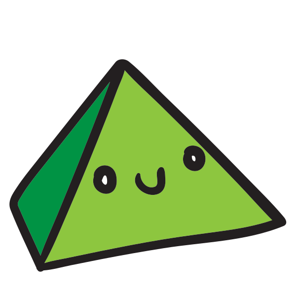 | [Smiling Triangle](https://github.com/MariaLetta/mega-doodles-pack/blob/4383d4323ddf11d79523ae9ee961ab5a08283d0d/doodles/svg/doodle-06.svg) | decorative |
| 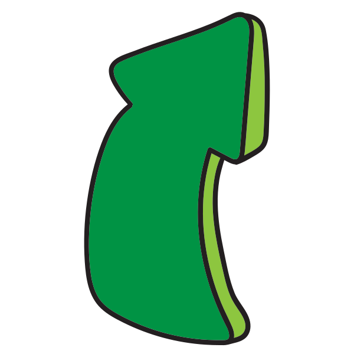 | [Curved Green Arrow](https://github.com/MariaLetta/mega-doodles-pack/blob/4383d4323ddf11d79523ae9ee961ab5a08283d0d/doodles/svg/doodle-10.svg) | decorative |
| 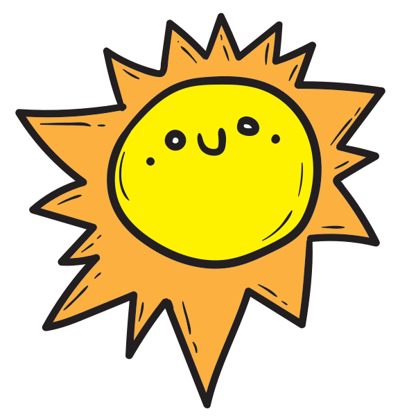 | [Smiling Sun](https://github.com/MariaLetta/mega-doodles-pack/blob/4383d4323ddf11d79523ae9ee961ab5a08283d0d/doodles/svg/doodle-21.svg) | decorative |
|  | [Red Rocket](https://github.com/MariaLetta/mega-doodles-pack/blob/4383d4323ddf11d79523ae9ee961ab5a08283d0d/doodles/svg/doodle-34.svg) | decorative |
| 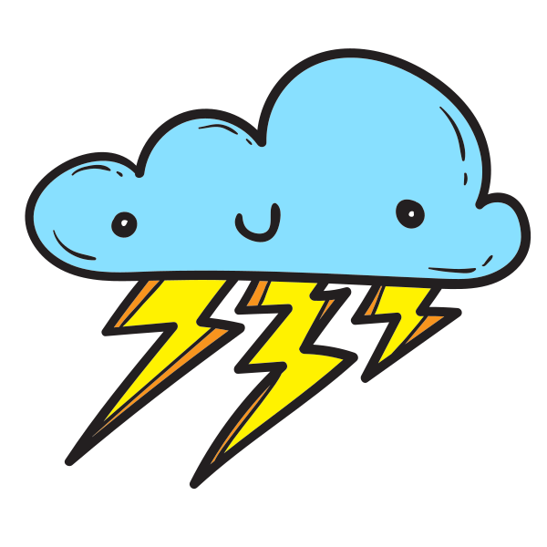 | [Lightning Cloud](https://github.com/MariaLetta/mega-doodles-pack/blob/4383d4323ddf11d79523ae9ee961ab5a08283d0d/doodles/svg/doodle-37.svg) | decorative |
|  | [Smiling Book](https://github.com/MariaLetta/mega-doodles-pack/blob/4383d4323ddf11d79523ae9ee961ab5a08283d0d/doodles/svg/doodle-45.svg) | decorative |
|  | [Shooting Star](https://github.com/MariaLetta/mega-doodles-pack/blob/4383d4323ddf11d79523ae9ee961ab5a08283d0d/doodles/svg/doodle-58.svg) | decorative |
|  | [Thumbs Up Card](https://github.com/MariaLetta/mega-doodles-pack/blob/4383d4323ddf11d79523ae9ee961ab5a08283d0d/doodles/svg/doodle-61.svg) | decorative |
|  | [Yellow Pencil](https://github.com/MariaLetta/mega-doodles-pack/blob/4383d4323ddf11d79523ae9ee961ab5a08283d0d/doodles/svg/doodle-68.svg) | decorative |
|  | [Paper Plane](https://github.com/MariaLetta/mega-doodles-pack/blob/4383d4323ddf11d79523ae9ee961ab5a08283d0d/doodles/svg/doodle-90.svg) | decorative |
|  | [Red Pencil](https://github.com/MariaLetta/mega-doodles-pack/blob/4383d4323ddf11d79523ae9ee961ab5a08283d0d/doodles/svg/doodle-96.svg) | decorative |
| 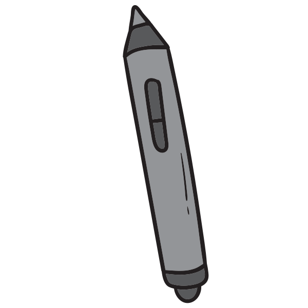 | [Stylus](https://github.com/MariaLetta/mega-doodles-pack/blob/4383d4323ddf11d79523ae9ee961ab5a08283d0d/doodles/svg/doodle-105.svg) | decorative |
|  | [Stack Of Notes](https://github.com/MariaLetta/mega-doodles-pack/blob/4383d4323ddf11d79523ae9ee961ab5a08283d0d/doodles/svg/doodle-106.svg) | decorative |
|  | [Star Speech Bubble](https://github.com/MariaLetta/mega-doodles-pack/blob/4383d4323ddf11d79523ae9ee961ab5a08283d0d/doodles/svg/doodle-119.svg) | decorative |
|  | [Light Bulb](https://github.com/MariaLetta/mega-doodles-pack/blob/4383d4323ddf11d79523ae9ee961ab5a08283d0d/doodles/svg/doodle-122.svg) | decorative |
|  | [Wavy Arrow](https://github.com/MariaLetta/mega-doodles-pack/blob/4383d4323ddf11d79523ae9ee961ab5a08283d0d/doodles/svg/doodle-126.svg) | decorative |
|  | [Sparkling Shooting Star](https://github.com/MariaLetta/mega-doodles-pack/blob/4383d4323ddf11d79523ae9ee961ab5a08283d0d/doodles/svg/doodle-137.svg) | decorative |
|  | [Blue Arrow](https://github.com/MariaLetta/mega-doodles-pack/blob/4383d4323ddf11d79523ae9ee961ab5a08283d0d/doodles/svg/doodle-139.svg) | decorative |
|  | [Round Speech Bubble](https://github.com/MariaLetta/mega-doodles-pack/blob/4383d4323ddf11d79523ae9ee961ab5a08283d0d/doodles/svg/doodle-152.svg) | decorative |
| 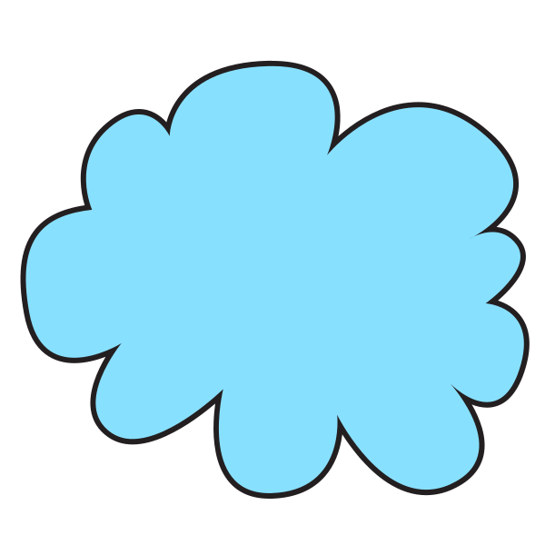 | [Cloud Bubble](https://github.com/MariaLetta/mega-doodles-pack/blob/4383d4323ddf11d79523ae9ee961ab5a08283d0d/doodles/svg/doodle-153.svg) | decorative |
| 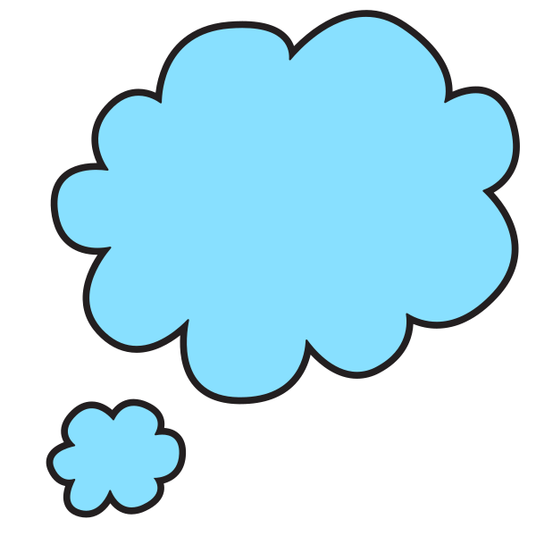 | [Thought Bubble](https://github.com/MariaLetta/mega-doodles-pack/blob/4383d4323ddf11d79523ae9ee961ab5a08283d0d/doodles/svg/doodle-155.svg) | decorative |
| 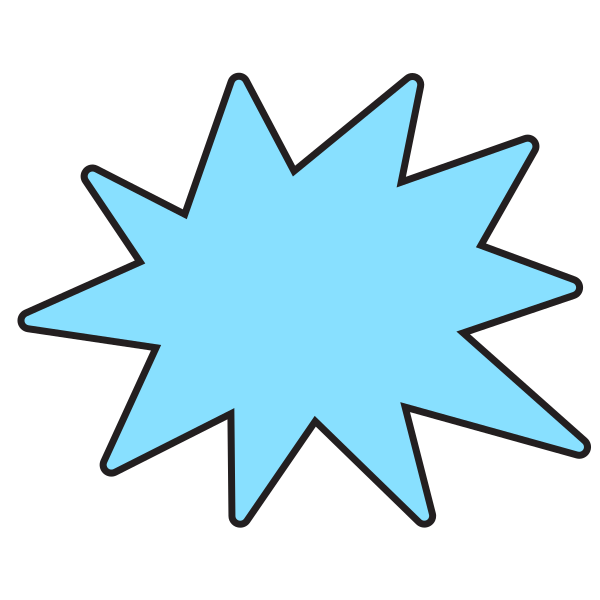 | [Burst Bubble](https://github.com/MariaLetta/mega-doodles-pack/blob/4383d4323ddf11d79523ae9ee961ab5a08283d0d/doodles/svg/doodle-156.svg) | decorative |
|  | [Wide Speech Bubble](https://github.com/MariaLetta/mega-doodles-pack/blob/4383d4323ddf11d79523ae9ee961ab5a08283d0d/doodles/svg/doodle-159.svg) | decorative |
| 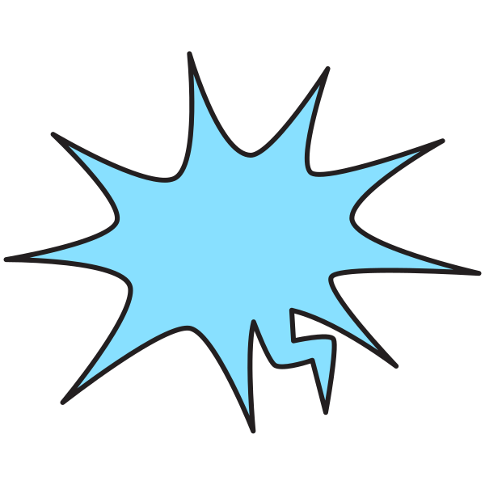 | [Spiky Burst Bubble](https://github.com/MariaLetta/mega-doodles-pack/blob/4383d4323ddf11d79523ae9ee961ab5a08283d0d/doodles/svg/doodle-160.svg) | decorative |
| 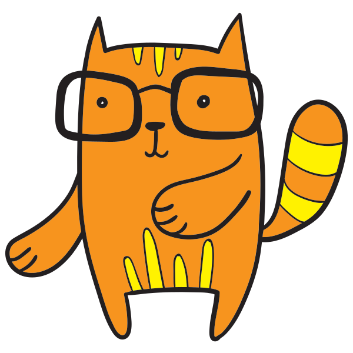 | [Cat With Glasses](https://github.com/MariaLetta/mega-doodles-pack/blob/4383d4323ddf11d79523ae9ee961ab5a08283d0d/doodles/svg/doodle-01.svg) | decorative |
| 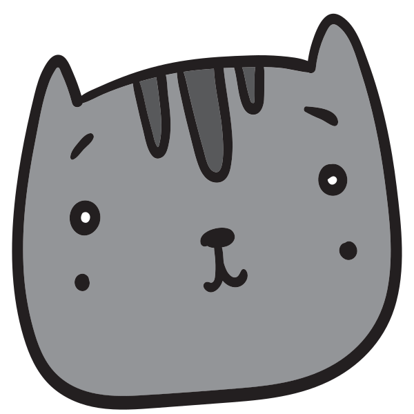 | [Grey Cat](https://github.com/MariaLetta/mega-doodles-pack/blob/4383d4323ddf11d79523ae9ee961ab5a08283d0d/doodles/svg/doodle-02.svg) | decorative |
| 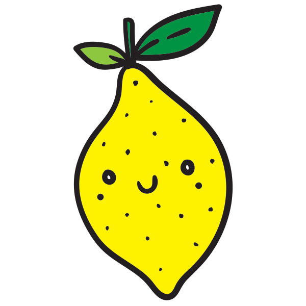 | [Lemon](https://github.com/MariaLetta/mega-doodles-pack/blob/4383d4323ddf11d79523ae9ee961ab5a08283d0d/doodles/svg/doodle-04.svg) | decorative |
| 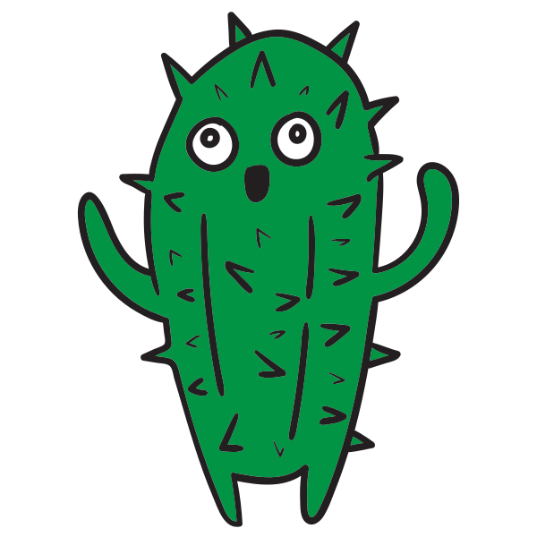 | [Cactus](https://github.com/MariaLetta/mega-doodles-pack/blob/4383d4323ddf11d79523ae9ee961ab5a08283d0d/doodles/svg/doodle-07.svg) | decorative |
| 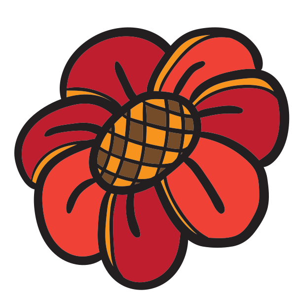 | [Flower](https://github.com/MariaLetta/mega-doodles-pack/blob/4383d4323ddf11d79523ae9ee961ab5a08283d0d/doodles/svg/doodle-13.svg) | decorative |
| 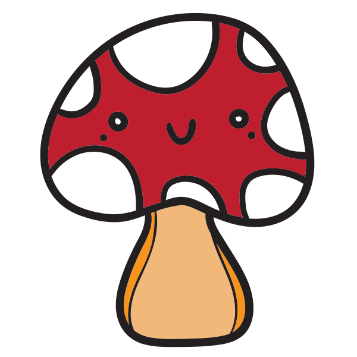 | [Mushroom](https://github.com/MariaLetta/mega-doodles-pack/blob/4383d4323ddf11d79523ae9ee961ab5a08283d0d/doodles/svg/doodle-18.svg) | decorative |
|  | [Fox Face](https://github.com/MariaLetta/mega-doodles-pack/blob/4383d4323ddf11d79523ae9ee961ab5a08283d0d/doodles/svg/doodle-25.svg) | decorative |
| 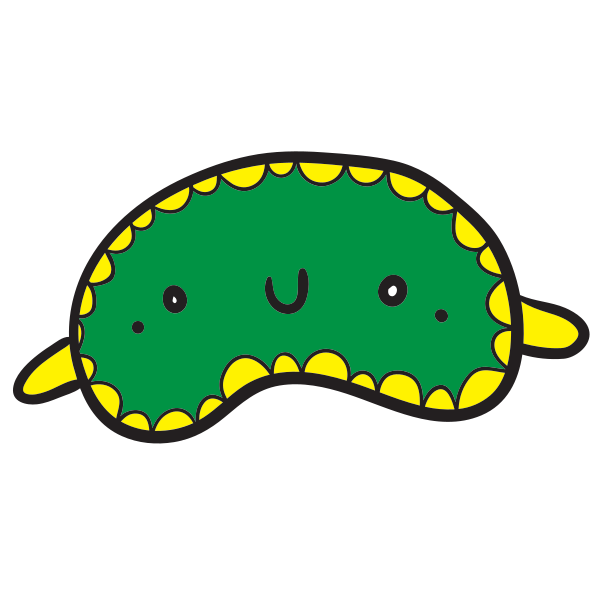 | [Caterpillar](https://github.com/MariaLetta/mega-doodles-pack/blob/4383d4323ddf11d79523ae9ee961ab5a08283d0d/doodles/svg/doodle-29.svg) | decorative |
| 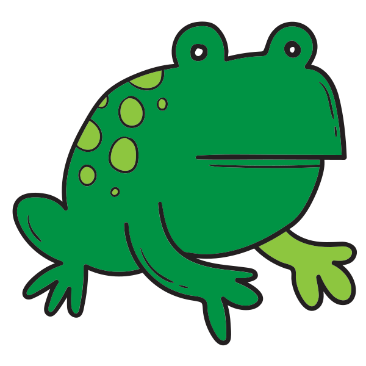 | [Frog](https://github.com/MariaLetta/mega-doodles-pack/blob/4383d4323ddf11d79523ae9ee961ab5a08283d0d/doodles/svg/doodle-31.svg) | decorative |
|  | [Narwhal](https://github.com/MariaLetta/mega-doodles-pack/blob/4383d4323ddf11d79523ae9ee961ab5a08283d0d/doodles/svg/doodle-36.svg) | decorative |
| 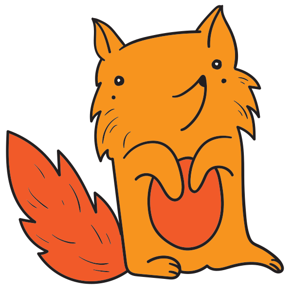 | [Fox](https://github.com/MariaLetta/mega-doodles-pack/blob/4383d4323ddf11d79523ae9ee961ab5a08283d0d/doodles/svg/doodle-43.svg) | decorative |
|  | [Coffee Cup](https://github.com/MariaLetta/mega-doodles-pack/blob/4383d4323ddf11d79523ae9ee961ab5a08283d0d/doodles/svg/doodle-46.svg) | decorative |
| 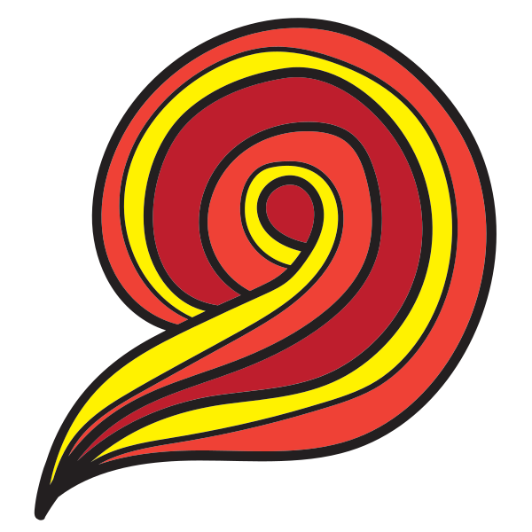 | [Colorful Heart](https://github.com/MariaLetta/mega-doodles-pack/blob/4383d4323ddf11d79523ae9ee961ab5a08283d0d/doodles/svg/doodle-55.svg) | decorative |
| 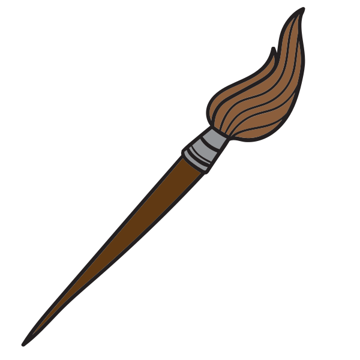 | [Paintbrush](https://github.com/MariaLetta/mega-doodles-pack/blob/4383d4323ddf11d79523ae9ee961ab5a08283d0d/doodles/svg/doodle-71.svg) | decorative |
| 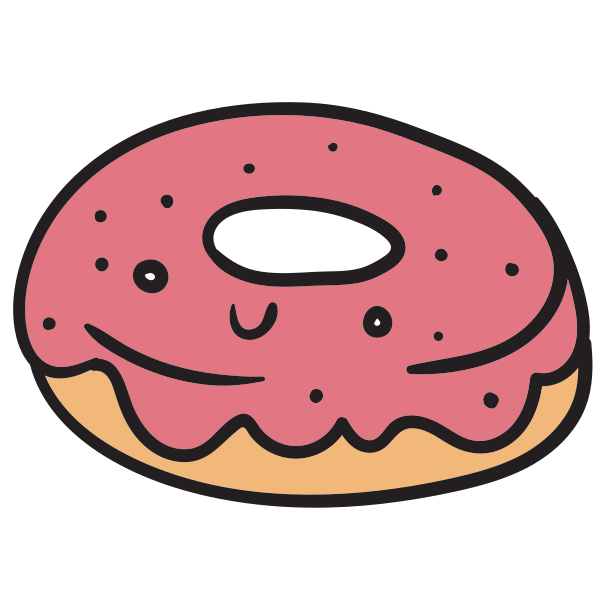 | [Doughnut](https://github.com/MariaLetta/mega-doodles-pack/blob/4383d4323ddf11d79523ae9ee961ab5a08283d0d/doodles/svg/doodle-85.svg) | decorative |
| 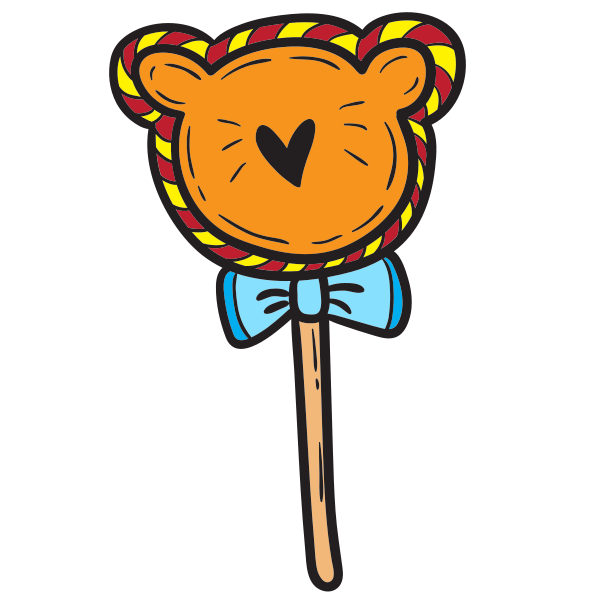 | [Cat Lollipop](https://github.com/MariaLetta/mega-doodles-pack/blob/4383d4323ddf11d79523ae9ee961ab5a08283d0d/doodles/svg/doodle-87.svg) | decorative |
| 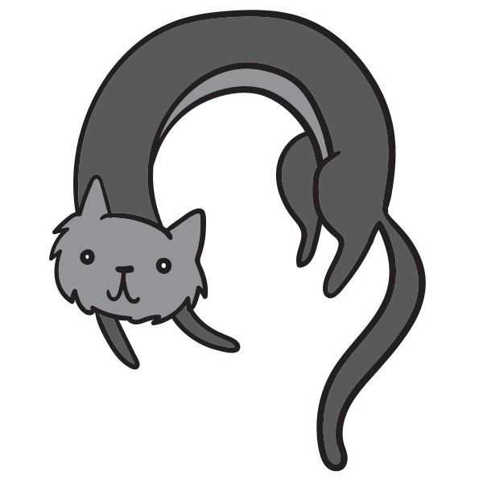 | [Tea Cup](https://github.com/MariaLetta/mega-doodles-pack/blob/4383d4323ddf11d79523ae9ee961ab5a08283d0d/doodles/svg/doodle-99.svg) | decorative |
| 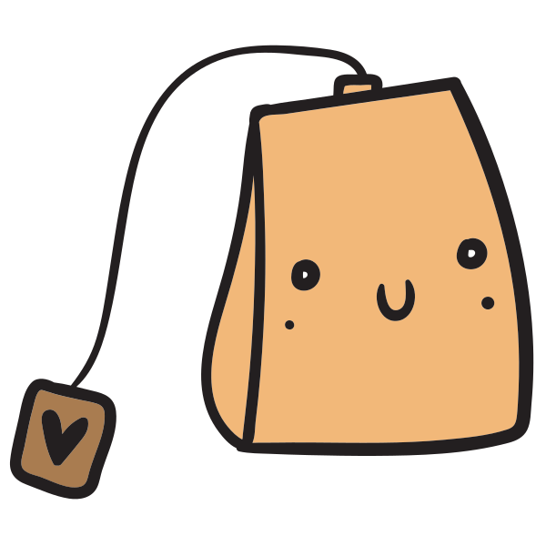 | [Tea Bag](https://github.com/MariaLetta/mega-doodles-pack/blob/4383d4323ddf11d79523ae9ee961ab5a08283d0d/doodles/svg/doodle-113.svg) | decorative |
|  | [Rainbow](https://github.com/MariaLetta/mega-doodles-pack/blob/4383d4323ddf11d79523ae9ee961ab5a08283d0d/doodles/svg/doodle-124.svg) | decorative |
| 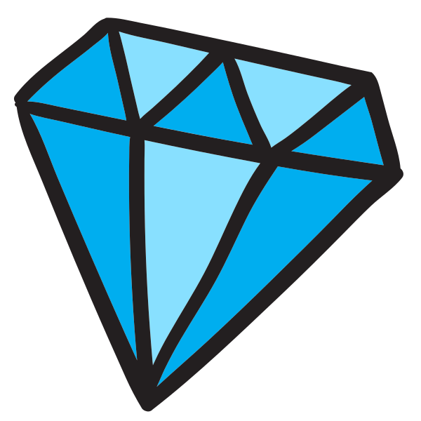 | [Blue Gem](https://github.com/MariaLetta/mega-doodles-pack/blob/4383d4323ddf11d79523ae9ee961ab5a08283d0d/doodles/svg/doodle-125.svg) | decorative |
| 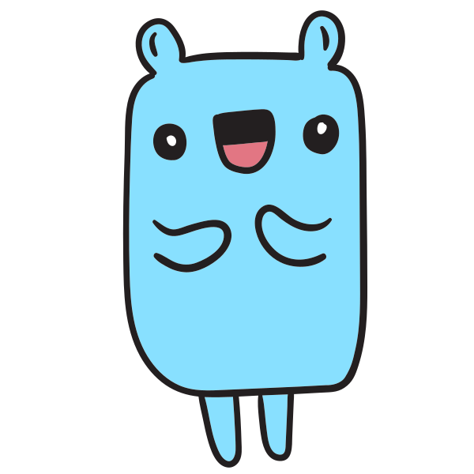 | [Blue Character](https://github.com/MariaLetta/mega-doodles-pack/blob/4383d4323ddf11d79523ae9ee961ab5a08283d0d/doodles/svg/doodle-135.svg) | decorative |
|  | [Pink Heart](https://github.com/MariaLetta/mega-doodles-pack/blob/4383d4323ddf11d79523ae9ee961ab5a08283d0d/doodles/svg/doodle-143.svg) | decorative |
| 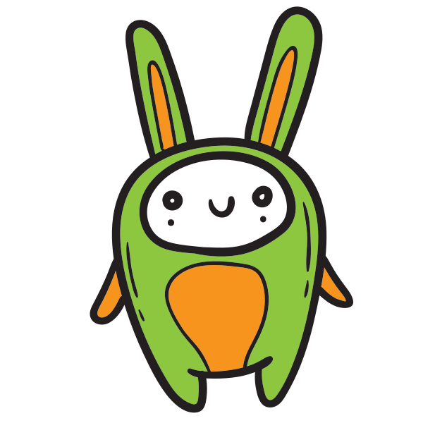 | [Bunny Costume](https://github.com/MariaLetta/mega-doodles-pack/blob/4383d4323ddf11d79523ae9ee961ab5a08283d0d/doodles/svg/doodle-03.svg) | decorative |
| 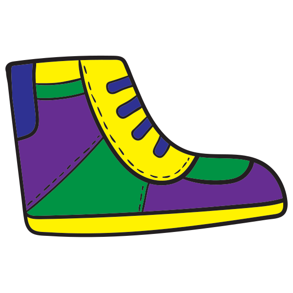 | [Colorful Sneaker](https://github.com/MariaLetta/mega-doodles-pack/blob/4383d4323ddf11d79523ae9ee961ab5a08283d0d/doodles/svg/doodle-09.svg) | decorative |
| 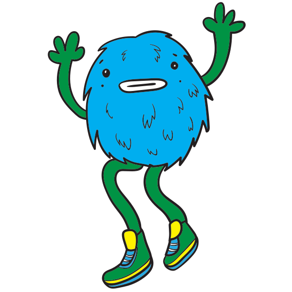 | [Waving Blue Monster](https://github.com/MariaLetta/mega-doodles-pack/blob/4383d4323ddf11d79523ae9ee961ab5a08283d0d/doodles/svg/doodle-11.svg) | decorative |
| 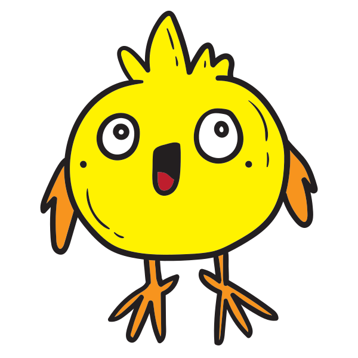 | [Surprised Chick](https://github.com/MariaLetta/mega-doodles-pack/blob/4383d4323ddf11d79523ae9ee961ab5a08283d0d/doodles/svg/doodle-12.svg) | decorative |
|  | [Blue Bird](https://github.com/MariaLetta/mega-doodles-pack/blob/4383d4323ddf11d79523ae9ee961ab5a08283d0d/doodles/svg/doodle-15.svg) | decorative |
| 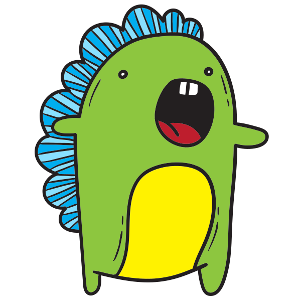 | [Green Monster](https://github.com/MariaLetta/mega-doodles-pack/blob/4383d4323ddf11d79523ae9ee961ab5a08283d0d/doodles/svg/doodle-17.svg) | decorative |
|  | [Sleepy Blue Blob](https://github.com/MariaLetta/mega-doodles-pack/blob/4383d4323ddf11d79523ae9ee961ab5a08283d0d/doodles/svg/doodle-20.svg) | decorative |
| 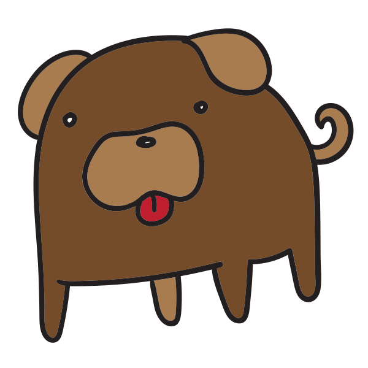 | [Brown Pig](https://github.com/MariaLetta/mega-doodles-pack/blob/4383d4323ddf11d79523ae9ee961ab5a08283d0d/doodles/svg/doodle-22.svg) | decorative |
| 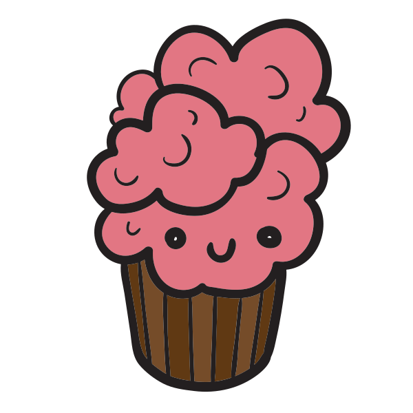 | [Pink Cupcake](https://github.com/MariaLetta/mega-doodles-pack/blob/4383d4323ddf11d79523ae9ee961ab5a08283d0d/doodles/svg/doodle-24.svg) | decorative |
|  | [Yellow Square Character](https://github.com/MariaLetta/mega-doodles-pack/blob/4383d4323ddf11d79523ae9ee961ab5a08283d0d/doodles/svg/doodle-26.svg) | decorative |
|  | [Hand Mirror](https://github.com/MariaLetta/mega-doodles-pack/blob/4383d4323ddf11d79523ae9ee961ab5a08283d0d/doodles/svg/doodle-27.svg) | decorative |
|  | [White Blue Character](https://github.com/MariaLetta/mega-doodles-pack/blob/4383d4323ddf11d79523ae9ee961ab5a08283d0d/doodles/svg/doodle-28.svg) | decorative |
| 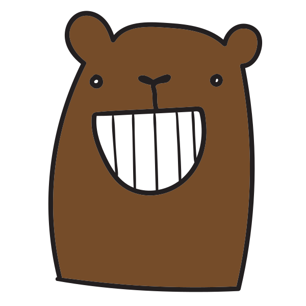 | [Grinning Bear](https://github.com/MariaLetta/mega-doodles-pack/blob/4383d4323ddf11d79523ae9ee961ab5a08283d0d/doodles/svg/doodle-32.svg) | decorative |
|  | [Blue Antler Creature](https://github.com/MariaLetta/mega-doodles-pack/blob/4383d4323ddf11d79523ae9ee961ab5a08283d0d/doodles/svg/doodle-33.svg) | decorative |
|  | [Orange Octopus](https://github.com/MariaLetta/mega-doodles-pack/blob/4383d4323ddf11d79523ae9ee961ab5a08283d0d/doodles/svg/doodle-38.svg) | decorative |
|  | [Cherry Cupcake](https://github.com/MariaLetta/mega-doodles-pack/blob/4383d4323ddf11d79523ae9ee961ab5a08283d0d/doodles/svg/doodle-41.svg) | decorative |
|  | [Yellow Happy Character](https://github.com/MariaLetta/mega-doodles-pack/blob/4383d4323ddf11d79523ae9ee961ab5a08283d0d/doodles/svg/doodle-42.svg) | decorative |
| 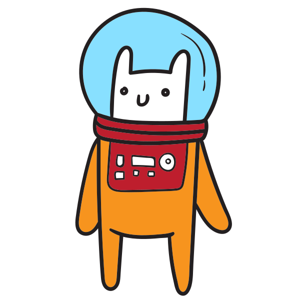 | [Astronaut Rabbit](https://github.com/MariaLetta/mega-doodles-pack/blob/4383d4323ddf11d79523ae9ee961ab5a08283d0d/doodles/svg/doodle-44.svg) | decorative |
|  | [Milk Carton](https://github.com/MariaLetta/mega-doodles-pack/blob/4383d4323ddf11d79523ae9ee961ab5a08283d0d/doodles/svg/doodle-50.svg) | decorative |
| 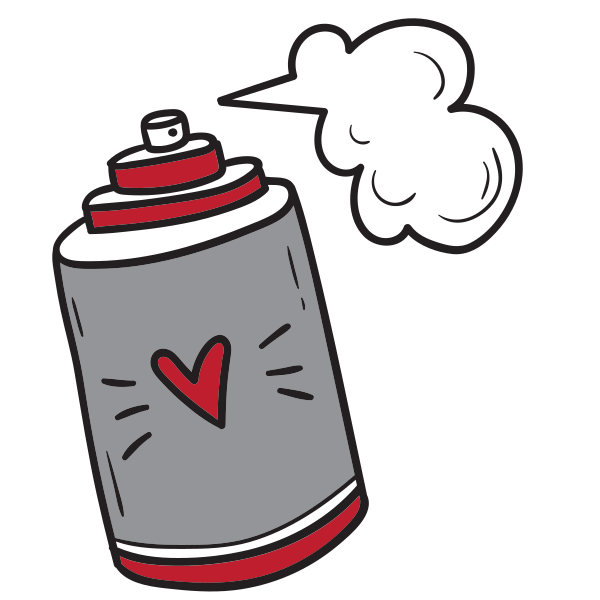 | [Spray Paint](https://github.com/MariaLetta/mega-doodles-pack/blob/4383d4323ddf11d79523ae9ee961ab5a08283d0d/doodles/svg/doodle-51.svg) | decorative |
|  | [Winged Smile](https://github.com/MariaLetta/mega-doodles-pack/blob/4383d4323ddf11d79523ae9ee961ab5a08283d0d/doodles/svg/doodle-52.svg) | decorative |
| 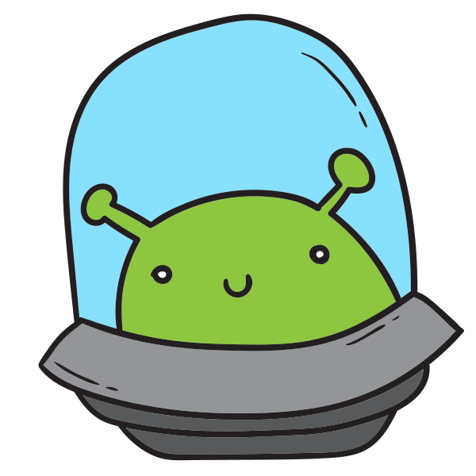 | [Ufo Alien](https://github.com/MariaLetta/mega-doodles-pack/blob/4383d4323ddf11d79523ae9ee961ab5a08283d0d/doodles/svg/doodle-57.svg) | decorative |
| 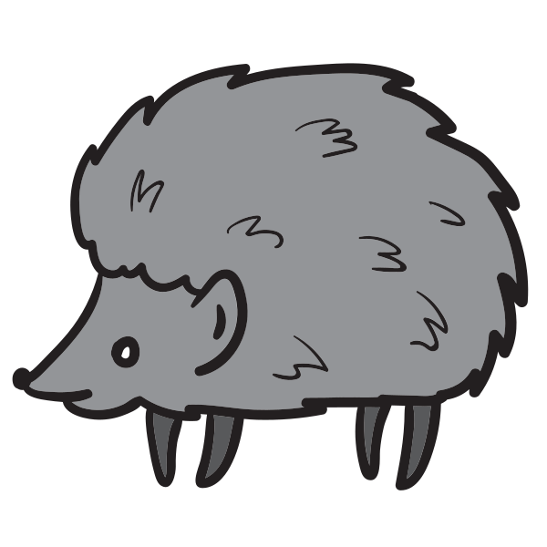 | [Hedgehog](https://github.com/MariaLetta/mega-doodles-pack/blob/4383d4323ddf11d79523ae9ee961ab5a08283d0d/doodles/svg/doodle-62.svg) | decorative |
| 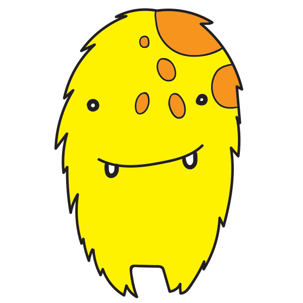 | [Yellow Fluffy Creature](https://github.com/MariaLetta/mega-doodles-pack/blob/4383d4323ddf11d79523ae9ee961ab5a08283d0d/doodles/svg/doodle-70.svg) | decorative |
| 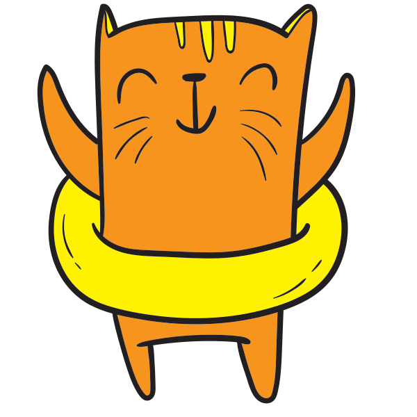 | [Stretching Orange Cat](https://github.com/MariaLetta/mega-doodles-pack/blob/4383d4323ddf11d79523ae9ee961ab5a08283d0d/doodles/svg/doodle-72.svg) | decorative |
|  | [Five Eyed Alien](https://github.com/MariaLetta/mega-doodles-pack/blob/4383d4323ddf11d79523ae9ee961ab5a08283d0d/doodles/svg/doodle-74.svg) | decorative |
| 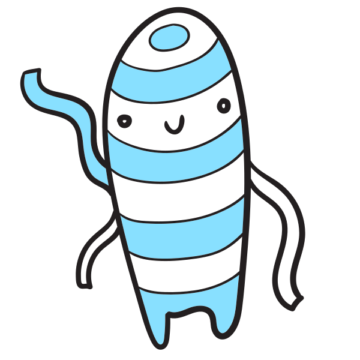 | [Striped Mummy](https://github.com/MariaLetta/mega-doodles-pack/blob/4383d4323ddf11d79523ae9ee961ab5a08283d0d/doodles/svg/doodle-75.svg) | decorative |
| 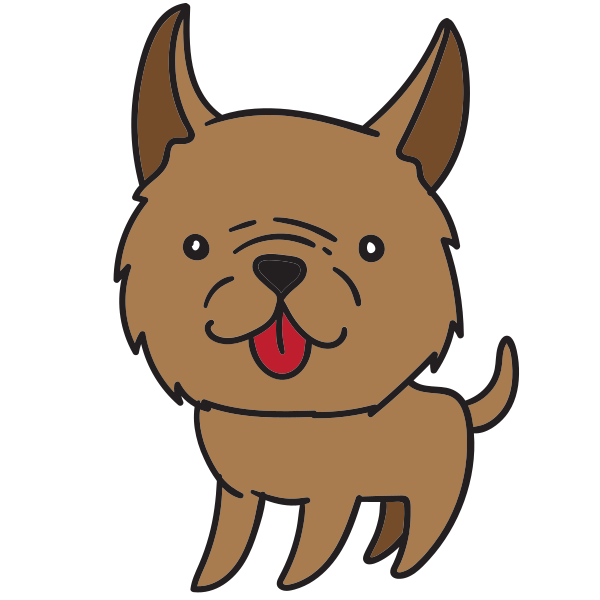 | [Brown Dog](https://github.com/MariaLetta/mega-doodles-pack/blob/4383d4323ddf11d79523ae9ee961ab5a08283d0d/doodles/svg/doodle-76.svg) | decorative |
|  | [Blue Ghost](https://github.com/MariaLetta/mega-doodles-pack/blob/4383d4323ddf11d79523ae9ee961ab5a08283d0d/doodles/svg/doodle-77.svg) | decorative |
| 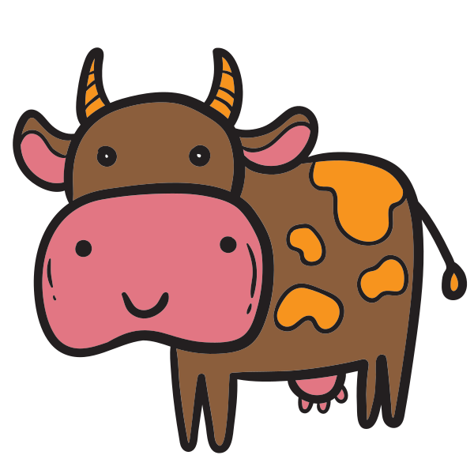 | [Cow](https://github.com/MariaLetta/mega-doodles-pack/blob/4383d4323ddf11d79523ae9ee961ab5a08283d0d/doodles/svg/doodle-78.svg) | decorative |
| 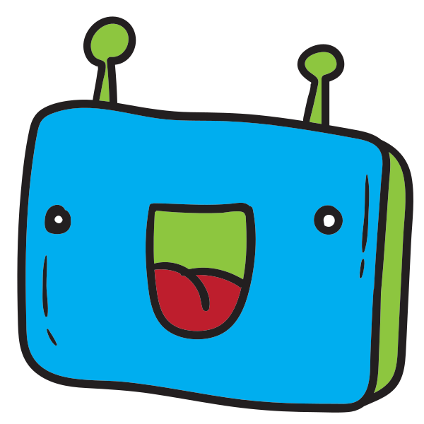 | [Smiling Robot](https://github.com/MariaLetta/mega-doodles-pack/blob/4383d4323ddf11d79523ae9ee961ab5a08283d0d/doodles/svg/doodle-83.svg) | decorative |
|  | [Red Lollipop](https://github.com/MariaLetta/mega-doodles-pack/blob/4383d4323ddf11d79523ae9ee961ab5a08283d0d/doodles/svg/doodle-86.svg) | decorative |
| 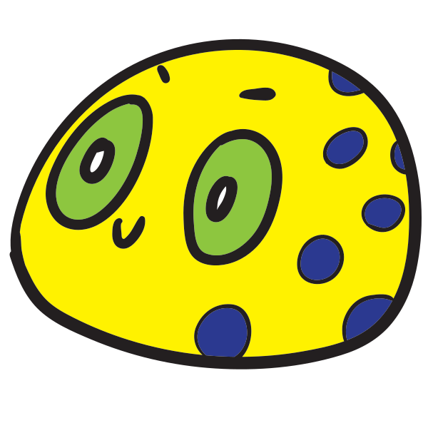 | [Green Spotted Creature](https://github.com/MariaLetta/mega-doodles-pack/blob/4383d4323ddf11d79523ae9ee961ab5a08283d0d/doodles/svg/doodle-91.svg) | decorative |
|  | [Blue Rocket](https://github.com/MariaLetta/mega-doodles-pack/blob/4383d4323ddf11d79523ae9ee961ab5a08283d0d/doodles/svg/doodle-93.svg) | decorative |
| 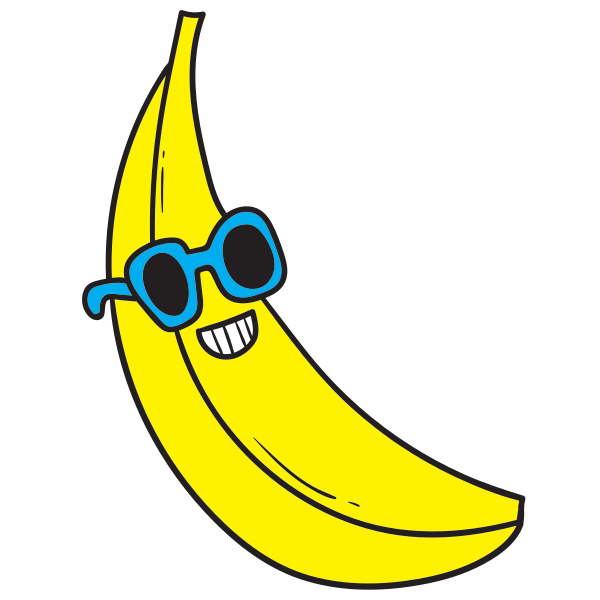 | [Banana With Glasses](https://github.com/MariaLetta/mega-doodles-pack/blob/4383d4323ddf11d79523ae9ee961ab5a08283d0d/doodles/svg/doodle-95.svg) | decorative |
| 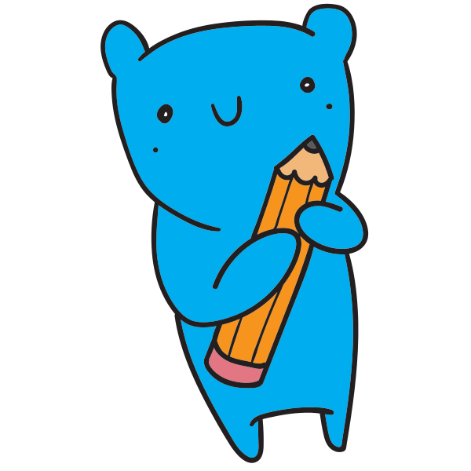 | [Blue Bear](https://github.com/MariaLetta/mega-doodles-pack/blob/4383d4323ddf11d79523ae9ee961ab5a08283d0d/doodles/svg/doodle-97.svg) | decorative |
|  | [Green Eye Monster](https://github.com/MariaLetta/mega-doodles-pack/blob/4383d4323ddf11d79523ae9ee961ab5a08283d0d/doodles/svg/doodle-102.svg) | decorative |
| 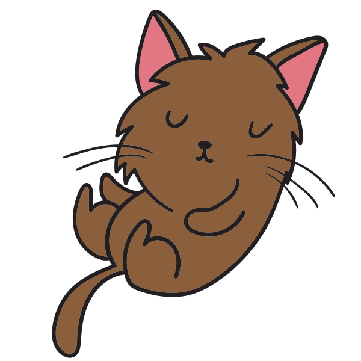 | [Toy Brick](https://github.com/MariaLetta/mega-doodles-pack/blob/4383d4323ddf11d79523ae9ee961ab5a08283d0d/doodles/svg/doodle-112.svg) | decorative |
| 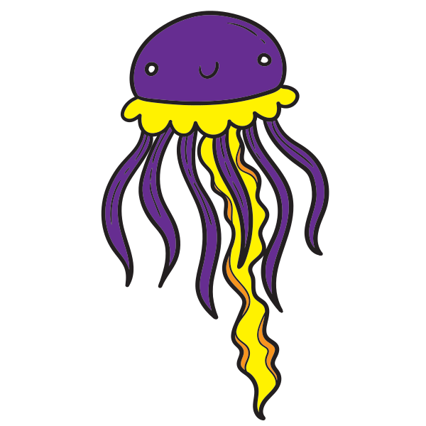 | [Jellyfish](https://github.com/MariaLetta/mega-doodles-pack/blob/4383d4323ddf11d79523ae9ee961ab5a08283d0d/doodles/svg/doodle-114.svg) | decorative |
|  | [Raccoon](https://github.com/MariaLetta/mega-doodles-pack/blob/4383d4323ddf11d79523ae9ee961ab5a08283d0d/doodles/svg/doodle-115.svg) | decorative |
| 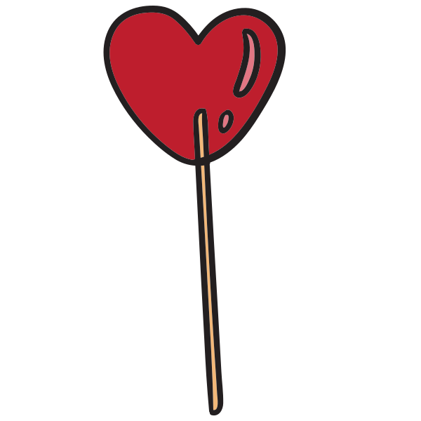 | [Heart Lollipop](https://github.com/MariaLetta/mega-doodles-pack/blob/4383d4323ddf11d79523ae9ee961ab5a08283d0d/doodles/svg/doodle-117.svg) | decorative |
|  | [Cherry Cupcake Alt](https://github.com/MariaLetta/mega-doodles-pack/blob/4383d4323ddf11d79523ae9ee961ab5a08283d0d/doodles/svg/doodle-123.svg) | decorative |
|  | [Green Swirl](https://github.com/MariaLetta/mega-doodles-pack/blob/4383d4323ddf11d79523ae9ee961ab5a08283d0d/doodles/svg/doodle-129.svg) | decorative |
|  | [Cherries](https://github.com/MariaLetta/mega-doodles-pack/blob/4383d4323ddf11d79523ae9ee961ab5a08283d0d/doodles/svg/doodle-130.svg) | decorative |
|  | [Envelope](https://github.com/MariaLetta/mega-doodles-pack/blob/4383d4323ddf11d79523ae9ee961ab5a08283d0d/doodles/svg/doodle-131.svg) | decorative |
|  | [Watermelon](https://github.com/MariaLetta/mega-doodles-pack/blob/4383d4323ddf11d79523ae9ee961ab5a08283d0d/doodles/svg/doodle-132.svg) | decorative |
|  | [Rainbow Lollipop](https://github.com/MariaLetta/mega-doodles-pack/blob/4383d4323ddf11d79523ae9ee961ab5a08283d0d/doodles/svg/doodle-133.svg) | decorative |
|  | [Popcorn](https://github.com/MariaLetta/mega-doodles-pack/blob/4383d4323ddf11d79523ae9ee961ab5a08283d0d/doodles/svg/doodle-134.svg) | decorative |
|  | [Cactus Cluster](https://github.com/MariaLetta/mega-doodles-pack/blob/4383d4323ddf11d79523ae9ee961ab5a08283d0d/doodles/svg/doodle-136.svg) | decorative |
|  | [Heart Notification](https://github.com/MariaLetta/mega-doodles-pack/blob/4383d4323ddf11d79523ae9ee961ab5a08283d0d/doodles/svg/doodle-138.svg) | decorative |
|  | [Curly Speech Bubble](https://github.com/MariaLetta/mega-doodles-pack/blob/4383d4323ddf11d79523ae9ee961ab5a08283d0d/doodles/svg/doodle-150.svg) | decorative |
|  | [Square Speech Bubble](https://github.com/MariaLetta/mega-doodles-pack/blob/4383d4323ddf11d79523ae9ee961ab5a08283d0d/doodles/svg/doodle-154.svg) | decorative |
|  | [Tall Speech Bubble](https://github.com/MariaLetta/mega-doodles-pack/blob/4383d4323ddf11d79523ae9ee961ab5a08283d0d/doodles/svg/doodle-157.svg) | decorative |
